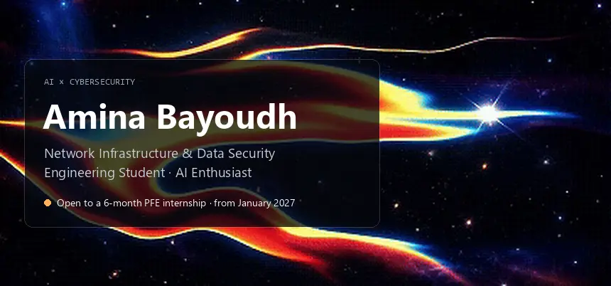

<!-- markdownlint-disable MD033 MD041 -->

  

  
  
  

  I build machine-learning systems that <b>detect attacks and help security teams respond</b>: 
  Transformers on live network traffic, LLM-assisted SOC workflows, and security platforms where the model suggests and a human decides.

### Work

| Project | What it does | Built with |
|---|---|---|
| [**DDoS Transformer Detection**](https://github.com/aminaoamina/DDos-Transformer-Based-Detection) | Attention over live TShark flow windows to flag DDoS in real time, with alerts sent to Wazuh | PyTorch, TShark, Wazuh |
| **ENIGMA** | Open-source SOC for banking: detection and zero-touch response to DDoS, brute force, malware, privilege escalation and phishing, with LLM alert triage | Wazuh, Shuffle SOAR, Keycloak, MidPoint |
| [**FIN-SHIELD**](https://github.com/aminaoamina/FIN-SHIELD-Transformer-Risk-Engine) | Two-level attention over a taxpayer's declaration history to rank cases for human review · **PR-AUC 0.92** | PyTorch |
| [**Phishing Detection Pipeline**](https://github.com/aminaoamina/Phishing-Project) | Watches Gmail and quarantines phishing using LLM text analysis, an XGBoost URL model and PhishTank | CrewAI, XGBoost |
| [**APTISO**](https://github.com/aminaoamina/APTISO) | ISO 27001 compliance platform with RAG and OCR to review evidence, under human validation | NestJS, Next.js, FastAPI, pgvector |
| [**FortiFlow**](https://gitlab.com/dev_sec_ops3/fortiflow) | GitLab CI/CD pipeline that blocks merges on leaked secrets, vulnerable code, images or IaC | Gitleaks, Semgrep, Trivy, Checkov, ZAP |

<h3 align="center">Toolbox</h3>

**AI & Machine Learning**

**Security & SOC**

**Development**

**Data & DevOps**

### Highlights

- **4th place**, IEEE TSYP13 EMBS CIS WIE Challenge, with LotusAura (AI healthcare platform)
- **NVIDIA DLI** certified: Fundamentals of Deep Learning · Rapid Application Development with LLMs · Generative AI with Diffusion Models
